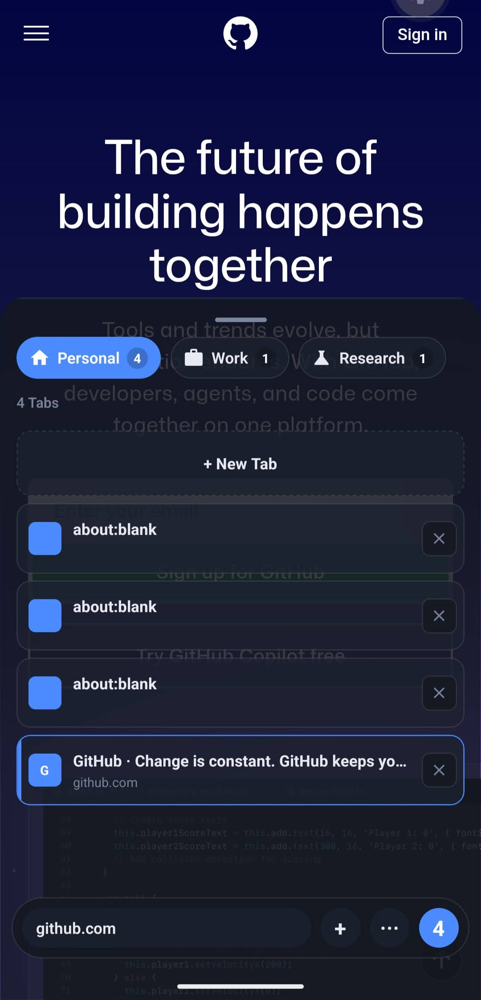
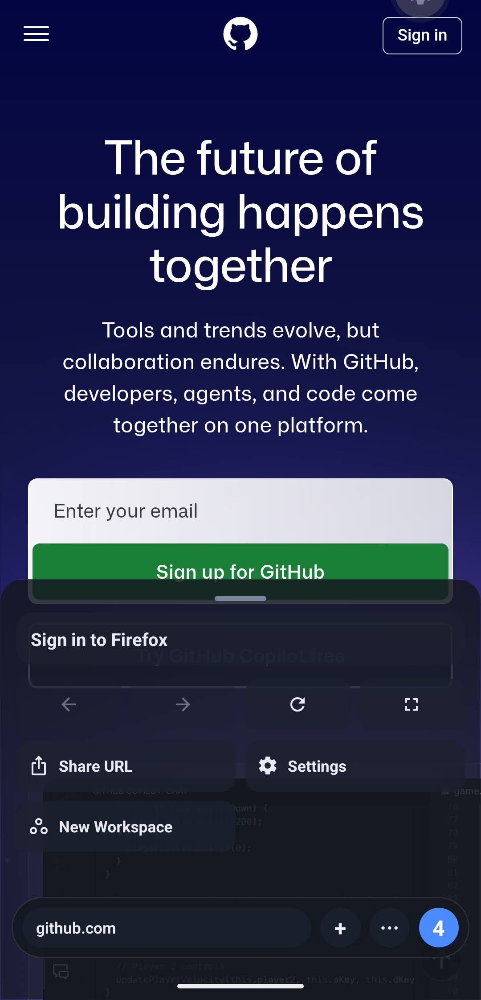
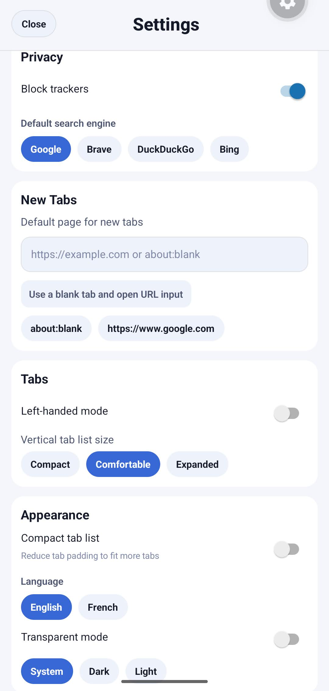

# Drift Browser

WARNING: This application has been developed by ai agents. It may contain bugs, security vulnerabilities, and other issues. Use at your own risk.

Technical setup and run instructions for the Expo/React Native workspace.

## Screenshots

<p align="center">
  
  
  
</p>

## Documentation

- User + development process guide: [docs/USER_GUIDE.md](docs/USER_GUIDE.md)
- Git/versioning workflow: [docs/GIT_VERSIONING_WORKFLOW.md](docs/GIT_VERSIONING_WORKFLOW.md)
- **Default settings configuration**: [DEFAULT_SETTINGS.md](DEFAULT_SETTINGS.md)

## Configuration

You can customize the default settings for new installations by editing `default-settings.ts`. This TypeScript file provides compile-time type safety - invalid configurations will prevent the app from building.

You can configure:
- Initial workspaces (name, icon, color)
- Default theme, search engine, language
- UI preferences (left-hand mode, compact lists, etc.)
- Default new tab URL

See [DEFAULT_SETTINGS.md](DEFAULT_SETTINGS.md) for the complete configuration reference.

**Note:** Changes require rebuilding the app to take effect.

## Requirements

- Node.js 20+
- npm 10+
- Android Studio for Android SDK/emulator
- Xcode for iOS builds (macOS only)

## Install

```bash
npm install
```

## Run (Development)

Start Metro/Expo:

```bash
npm run start
```

Targets:

- Android: `npm run android`
- iOS (macOS): `npm run ios`

Drift targets native Android and iOS apps; running Drift itself in a desktop web browser is not supported.

## Tab lifecycle and storage

Drift retains the three most recently used tabs across workspaces. Switching between retained tabs preserves their live page state and native back/forward history. Background media is allowed to continue while a tab remains cached (subject to OS and website restrictions). Opening a fourth live tab evicts the least recently used one; revisiting it reloads its saved URL, without restoring forms or native navigation history. Closing a tab disposes of its page immediately.

Tab URLs, titles, pins, workspaces, bookmarks, history and preferences are persisted. Loading, scrolling, fullscreen, media and navigation-command state are transient and reset on restart. Runtime-only and unchanged updates do not write the durable store.

## Regression Tests

```bash
npm test
```

The Node tests cover persistence/hydration, cache policy and menu rendering with mocked native APIs. Native device checks are still needed for page retention, gestures and background media.

## Type Check

```bash
npx tsc --noEmit
```

## Build

### EAS Cloud Builds (recommended)

```bash
npx eas login
npx eas build:configure
npx eas build --platform android
npx eas build --platform ios
```

### Local Native Builds

Android:

```bash
npx expo run:android
```

iOS (macOS):

```bash
npx expo run:ios
```

## Core Scripts

- `npm run start`
- `npm run android`
- `npm run ios`
- `npm test`

## Release Pipeline (Tag-Triggered)

1. Work from an issue on a focused branch (`fix/...`, `feat/...`, etc.).
2. Run checks needed for the change (`npx tsc --noEmit`, plus tests if applicable).
3. Start the release helper on the branch you want to release:

```bash
npm run release
# or: npm run release -- 1.4.0
```

This script generates release notes in `docs/releases/vX.Y.Z.md`, bumps app/package versions, commits, and creates/pushes tag `vX.Y.Z`.

When the tag is pushed, `.github/workflows/release-on-tag.yml` runs automatically and:

- builds Android via EAS (`production` profile),
- creates/updates the GitHub Release,
- appends EAS build/download links to the release notes,
- uploads `driftBrowser.apk` when the CI runner can download it.

Full process details: [docs/GIT_VERSIONING_WORKFLOW.md](docs/GIT_VERSIONING_WORKFLOW.md)

## Stack

- Expo SDK 55
- React Native 0.83
- React 19
- TypeScript
- Zustand + AsyncStorage
- React Native WebView
- React Native Gesture Handler + Reanimated
- React Navigation

## Project Layout

```text
.
|- App.tsx
|- app.json
|- docs/
|  |- USER_GUIDE.md
|  |- GIT_VERSIONING_WORKFLOW.md
|  \- releases/
|- src/
|  |- components/
|  |- hooks/
|  |- i18n/
|  |- screens/
|  |- services/
|  |- store/
|  |- theme/
|  \- types/
\- package.json
```

## Troubleshooting

Clear Metro cache:

```bash
npx expo start -c
```

Reinstall dependencies:

```bash
npm install
```

Verify Reanimated plugin in `babel.config.js` if gesture animations fail.